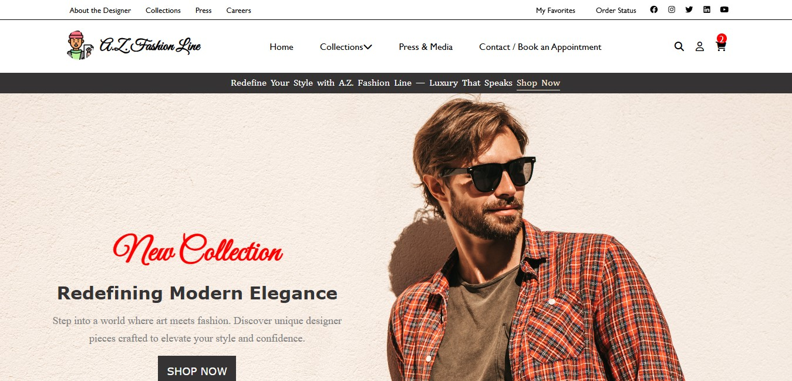

<p align="center">
  
</p>

# 👔 A.Z. Fashion Line

A modern fashion store website featuring men's, women's, and baby collections, trending products, and a clean, elegant layout.

> 💻 Designed for laptop and desktop screens.

🔗 **Live Demo:** [dev-ahmedissa.github.io/AZ-Fashion-Line](https://dev-ahmedissa.github.io/AZ-Fashion-Line/)

## 📸 Preview



## ✨ Features

- Top bar and main navigation with a collections dropdown menu
- Hero section with a promotional banner
- Categories: Men's, Women's, and Baby Fashion
- "Trending This Week" products with old and new prices
- Client testimonial section
- "You May Also Like" section with product videos
- Latest fashion news cards
- Store benefits: premium fabrics, secure payment, 14-day returns, 24/7 assistance
- Newsletter subscription section and detailed footer

## 🛠️ Built With

- HTML5
- CSS3

## 🚀 Run Locally

```bash
git clone https://github.com/dev-ahmedissa/AZ-Fashion-Line.git
cd AZ-Fashion-Line
```

Then open `index.html` in your browser.

## 📬 Contact

**Ahmed Issa**, Frontend Developer
[ahmednashatissa@gmail.com](mailto:ahmednashatissa@gmail.com) • [GitHub](https://github.com/dev-ahmedissa)
